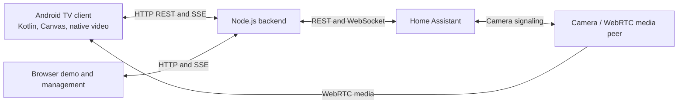

# Home TV Launcher

A native Android TV launcher with a Home Assistant dashboard, built around remote-control navigation and a screen that fits the TV.

The TV client is written in Kotlin and draws its main interface with Android Canvas. A separate Node.js backend reads your Home Assistant installation and provides a browser demo, management pages and the TV API. Deploying that backend on Home Assistant lets the TV run without a development computer.

This is a source release. Build an APK for **your own backend address** and configure **your own Home Assistant entities**. No preconfigured household APK, personal configuration or photos are included.

## What it includes

- App launcher, calendar, weather and household views operated with a directional remote.
- Explicit room mappings for temperature, humidity, CO₂, PM2.5, presence and equipment; missing measurements stay unavailable.
- Energy, water, laundry and vacuum panels where matching entities are configured.
- Configurable light and temperature controls through the backend's explicit capability model.
- Notifications and live updates through the backend's server-sent event stream.
- Native camera playback through Home Assistant WebRTC signaling, plus camera snapshots and HLS support. **Camera timing and device compatibility remain experimental.**
- A browser demonstration using simulated data, without Home Assistant credentials.

The interface currently uses Czech labels. Physical testing has been performed on a TCL Android/Google TV installation. **Xiaomi TVs, Xiaomi TV boxes and other manufacturers have not been verified.** Android version support alone does not guarantee launcher, decoder or remote behavior on another device.

The public edition includes the readouts and configured controls described above. **Physical door unlatching and the original household night macro are not included.** Their public endpoints remain unavailable and make no Home Assistant requests; implementing either requires a separately reviewed integration for your installation.

## Try the browser demo

Install Node.js 22, then run:

```sh
git clone https://github.com/michalschoniger-ops/home-tv-launcher.git
cd home-tv-launcher
npm start
```

Open [http://localhost:4317](http://localhost:4317). With no `HA_URL` or `HA_TOKEN` configured, the server selects its labeled demo mode. The backend currently uses Node's built-in APIs and has no npm runtime dependencies.

## Use it with your Home Assistant and TV

1. Add this repository to the **Home Assistant App Store**, install **Home TV Launcher**, and configure its public origin, pairing and entity mapping. The committed [`addon/`](addon/) directory is the self-contained app build context.
2. Build the Android client with `dashboardUrl` set to that backend's TV-reachable origin.
3. Install your APK on the TV and pair it using your backend's pairing code.

Detailed instructions: [installation and pairing](docs/setup.md), [configuration](docs/configuration.md), [Android build notes](android/README.md), and [Home Assistant app](ha-app/README.md).

Repository URL for the Home Assistant App Store:

```text
https://github.com/michalschoniger-ops/home-tv-launcher
```

For a standalone Node deployment, use the same backend with your own environment settings. [Setup](docs/setup.md) covers both deployment paths.

## How the pieces connect



Home Assistant credentials stay on the backend. The TV pairs with the backend and receives its own session. See [architecture](docs/architecture.md) for the media and event paths.

## Development

```sh
npm run check
npm test
node --test ha-app/test/*.test.mjs
npm run check:addon
```

The last command verifies that the committed Home Assistant app matches its source package. After changing backend code, regenerate that package as described in [development](docs/development.md).

CI runs Node.js 22 checks and Home Assistant packaging tests. A successful build or automated test does not establish smooth video playback or physical TV compatibility; those need separate device testing. Current boundaries are listed in [known limitations](docs/limitations.md).

## Support development

If this project is useful to you, you can [buy me a coffee ☕](https://ko-fi.com/michalschoniger) and support its continued development. Thank you!

## License and credits

Project code is licensed under [MIT](LICENSE). Bundled and build-time third-party components retain their own licenses; see [third-party notices](THIRD_PARTY_NOTICES.md).

Developed by [michalschoniger-ops](https://github.com/michalschoniger-ops) with assistance from **OpenAI Codex**. Home Assistant, Android, Google TV and the named media services are independent projects and products.
