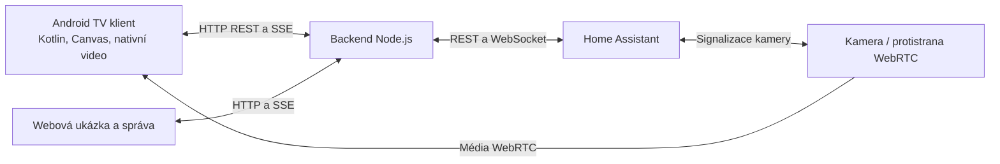

# HA TV Launcher

Nativní launcher pro Android TV s přehledem domácnosti z Home Assistantu. Ovládá se běžným směrovým ovladačem a hlavní obrazovky se vejdou na televizi bez posouvání.

https://github.com/user-attachments/assets/1043e4a9-a098-4e9b-b005-e4777946fe8d

[](https://github.com/michalschoniger-ops/ha-tv-launcher/raw/refs/heads/main/docs/ukazky/ha-tv-launcher-ukazka.mp4)

**[▶ Přehrát nebo stáhnout ukázkové video — Full HD, 48 sekund, bez zvuku](https://github.com/michalschoniger-ops/ha-tv-launcher/raw/refs/heads/main/docs/ukazky/ha-tv-launcher-ukazka.mp4)**

*Ukázka původní instalace; veřejná verze používá vlastní konfiguraci.*

| Místnosti | Aplikace |
|---|---|
| [](docs/ukazky/03-mistnosti.png) | [](docs/ukazky/07-aplikace.png) |

[Prohlédnout všech sedm snímků a video](docs/ukazky/README.md)

## Jak projekt funguje

TV klient je napsaný v Kotlinu a hlavní rozhraní kreslí pomocí Android Canvas. Samostatný backend v Node.js čte vaši instalaci Home Assistantu a poskytuje API pro televizi, webovou ukázku a správu. Backend může běžet přímo jako aplikace v Home Assistantu; vývojový počítač pak není součástí běžného provozu.

Projekt obsahuje zdrojové kódy a obecnou ukázkovou konfiguraci. APK si sestavíte pro **adresu svého backendu** a nastavíte **vlastní entity z Home Assistantu**.

## Co obsahuje

- Spouštění aplikací, kalendář, počasí a přehled domácnosti ovládaný směrovým ovladačem.
- Výslovné přiřazení čidel teploty, vlhkosti, CO₂, PM2.5, přítomnosti a vybavení k místnostem. Chybějící měření zůstávají nedostupná.
- Přehled energie, vody, pračky a vysavače podle nakonfigurovaných entit.
- Nastavitelné ovládání světel a teploty podle povolených funkcí backendu.
- Oznámení a průběžné aktualizace přes server-sent events (SSE).
- Nativní kamerový přehrávač se signalizací WebRTC přes Home Assistant, náhledy kamer a podporu HLS. **Časování kamer a kompatibilita zařízení jsou stále experimentální.**
- Webovou ukázku se simulovanými daty bez přihlašovacích údajů Home Assistantu.

Rozhraní je česky. Fyzické zkoušky proběhly na instalaci TCL s Android/Google TV. **Xiaomi TV, Xiaomi TV boxy ani ostatní výrobci zatím nejsou ověření.** Podporovaná verze Androidu sama nezaručuje stejné chování launcheru, dekodéru nebo ovladače na jiném zařízení.

Veřejná verze obsahuje uvedené přehledy a nastavitelné ovládání. **Fyzické otevření zámku a původní domácí noční makro její součástí nejsou.** Příslušná API zůstávají nedostupná a neposílají požadavky do Home Assistantu. Jejich doplnění vyžaduje samostatně prověřenou implementaci pro konkrétní instalaci.

## Vyzkoušení webové ukázky

Nainstalujte Node.js 22 a spusťte:

```sh
git clone https://github.com/michalschoniger-ops/ha-tv-launcher.git
cd ha-tv-launcher
npm start
```

Otevřete [http://localhost:4317](http://localhost:4317). Pokud nejsou nastavené `HA_URL` ani `HA_TOKEN`, server zvolí označený demonstrační režim. Backend nyní používá vestavěná API Node.js a nemá běhové závislosti z npm.

## Propojení s vlastní televizí a Home Assistantem

1. Přidejte tento repozitář do **Home Assistant App Store**, nainstalujte **HA TV Launcher** a nastavte adresu služby, párování a vlastní entity. Adresář [`addon/`](addon/) obsahuje samostatný sestavovací balík aplikace.
2. Sestavte Android klienta s `dashboardUrl` nastaveným na adresu backendu dostupnou z televize.
3. Nainstalujte vlastní APK do TV a zadejte svůj párovací kód.

Podrobnosti najdete v návodech pro [instalaci a párování](docs/setup.md), [konfiguraci](docs/configuration.md), [sestavení Android aplikace](android/README.md) a [aplikaci Home Assistantu](ha-app/README.md).

Adresa repozitáře pro Home Assistant App Store:

```text
https://github.com/michalschoniger-ops/ha-tv-launcher
```

Stejný backend lze provozovat i samostatně v Node.js. [Instalační návod](docs/setup.md) popisuje obě možnosti.

## Propojení jednotlivých částí



Přístupové údaje Home Assistantu zůstávají na backendu. Televize se spáruje s backendem a dostane vlastní relaci. Datové a mediální cesty popisuje [architektura](docs/architecture.md).

## Vývoj a kontroly

```sh
npm run check
npm test
node --test ha-app/test/*.test.mjs
npm run check:addon
```

Poslední příkaz ověřuje shodu dodávané aplikace Home Assistantu se zdrojovým balíkem. Po změně backendu balík znovu vygenerujte podle [vývojového návodu](docs/development.md).

CI spouští kontroly pro Node.js 22 a testy balíku Home Assistantu. Úspěšné sestavení nebo automatický test samy nepotvrzují plynulost videa ani kompatibilitu fyzické televize. Tyto vlastnosti potřebují samostatnou zkoušku na zařízení. Aktuální hranice popisují [známá omezení](docs/limitations.md).

## Podpora vývoje

Pokud vám projekt pomáhá, můžete mi [koupit kafe ☕](https://ko-fi.com/michalschoniger) a podpořit jeho další vývoj. Děkuji!

## Licence a autorství

Vlastní kód projektu je pod licencí [MIT](LICENSE). Přibalené komponenty a sestavovací nástroje si zachovávají své licence; podrobnosti jsou v [informacích o třetích stranách](THIRD_PARTY_NOTICES.md).

Projekt vyvíjí [michalschoniger-ops](https://github.com/michalschoniger-ops) s pomocí **OpenAI Codex**. Home Assistant, Android, Google TV a uvedené mediální služby jsou samostatné projekty a produkty.
