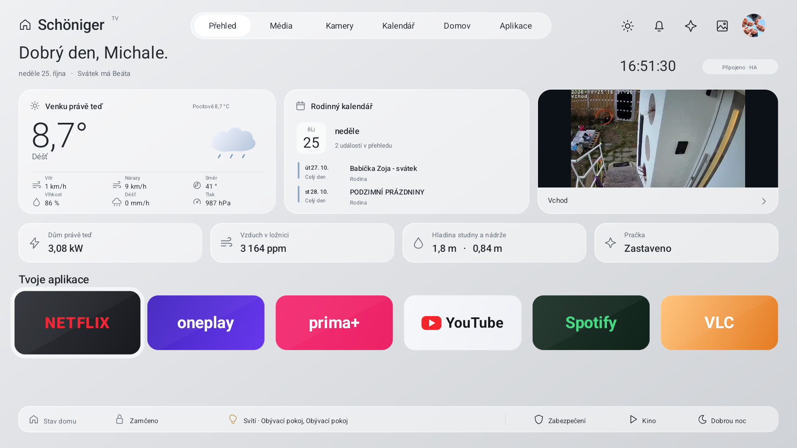
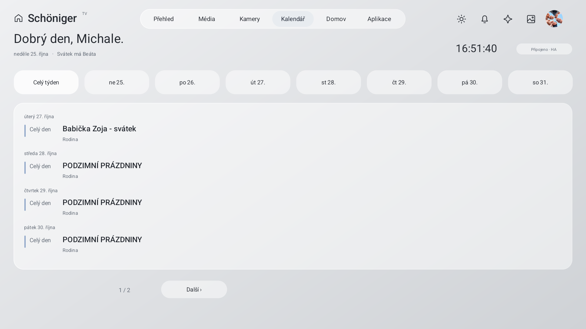
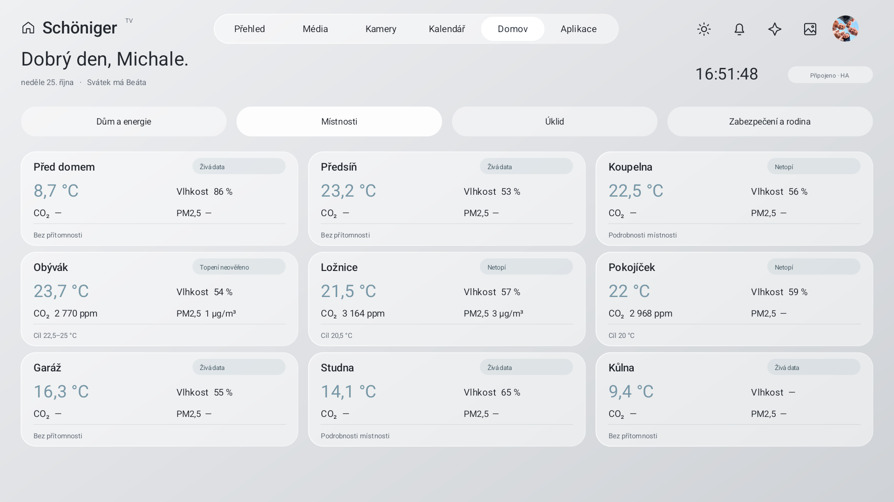
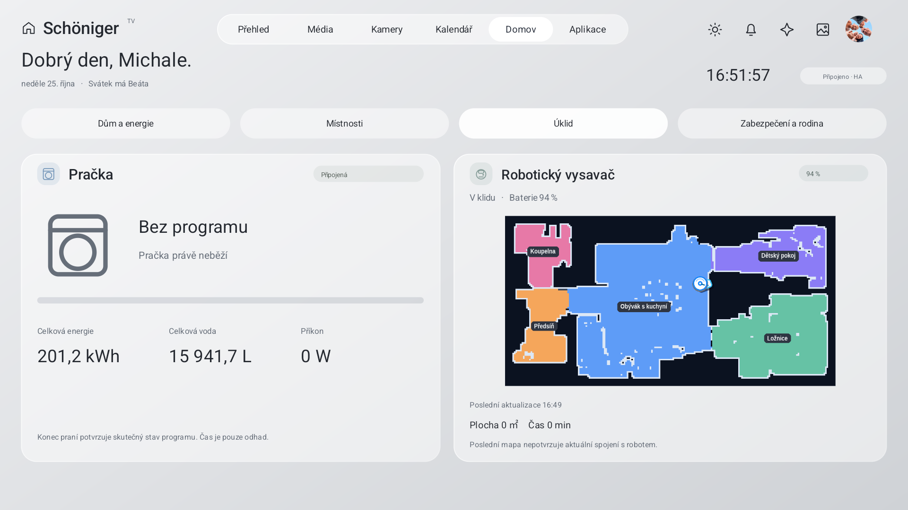
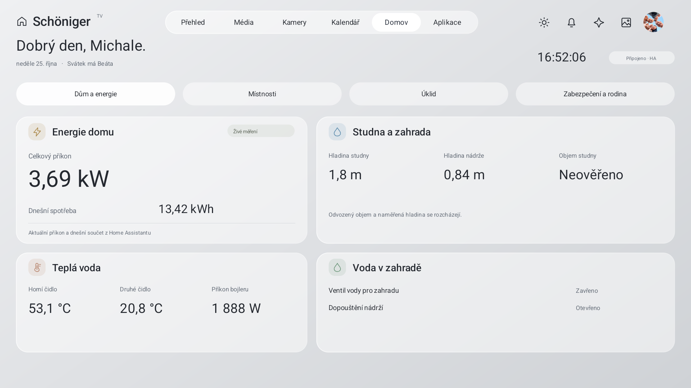
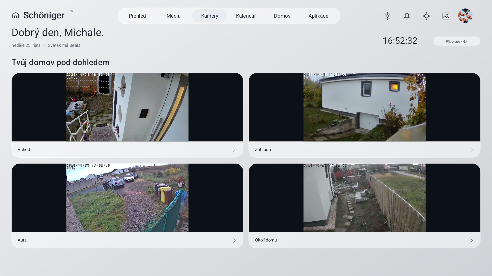
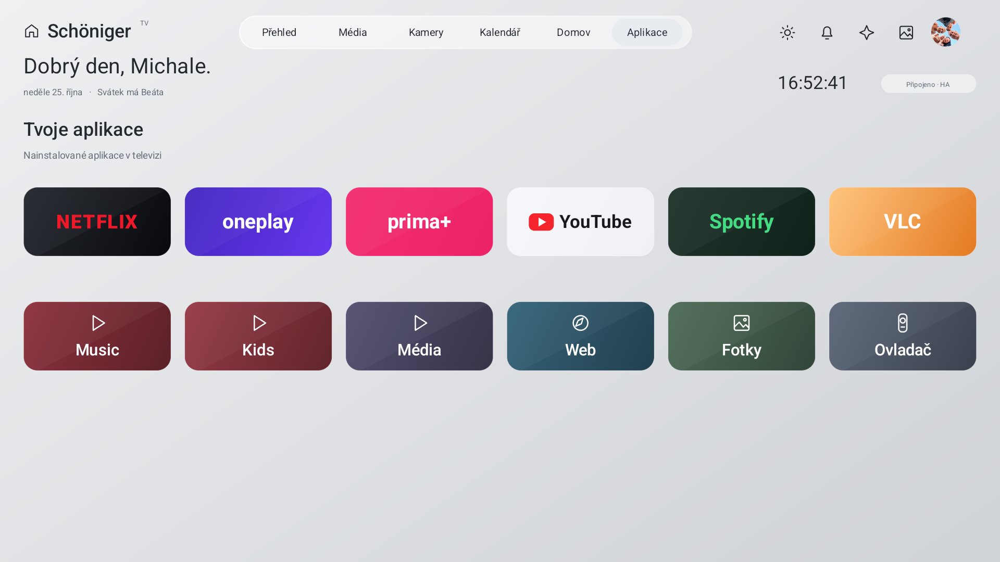

# Ukázky

Ukázka původní instalace; veřejná verze používá vlastní konfiguraci.

## Video

https://github.com/user-attachments/assets/1043e4a9-a098-4e9b-b005-e4777946fe8d

**[▶ Přehrát nebo stáhnout video](https://github.com/michalschoniger-ops/ha-tv-launcher/raw/refs/heads/main/docs/ukazky/ha-tv-launcher-ukazka.mp4)** — skutečný záznam z TV, přibližně 48 sekund, Full HD H.264, bez zvuku. Snímková frekvence záznamu je proměnná.

Video ukazuje Přehled, Média, Kamery, Kalendář, Místnosti, Úklid, Dům a energie, Aplikace a návrat na Přehled s vybraným Netflixem. Kamerový přehled obsahuje čtyři skutečné náhledy; samotná ukázka neověřuje plynulost plných HD přenosů.

## 1. Přehled

## 2. Kalendář

## 3. Místnosti

## 4. Úklid

## 5. Dům a energie

## 6. Kamery

## 7. Aplikace

Snímky mají rozlišení 1920 × 1080. Hodnoty odpovídají okamžiku pořízení a mohou se později změnit. Starší název viditelný v ukázkách patří původní instalaci; veřejný projekt se jmenuje **HA TV Launcher**.
